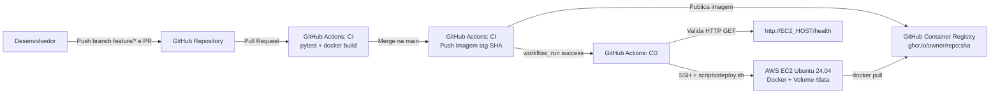

# Relatório Técnico — Esteira CI/CD na AWS EC2

## 1. Integrantes e Contribuições
- **Bernardo**: Implementação das evoluções da API (`DELETE /tasks/<id>` e filtro `GET /tasks?done=`), criação dos testes automatizados, configuração do repositório GitHub, provisionamento da instância EC2 e validação da esteira CI/CD.

---

## 2. Diagrama da Arquitetura e Fluxo CI/CD



---

## 3. Infraestrutura e Configuração de Rede (AWS EC2)

- **Provedor / Região:** AWS (`us-east-1`)
- **Sistema Operacional:** Ubuntu Server 24.04 LTS (x86_64)
- **Tipo de Instância:** `t2.micro` / `t3.micro` (Free Tier)
- **Container Runtime:** Docker Engine (instalado via `scripts/setup-ec2-ubuntu.sh`), rodando o contêiner `cloud-tasks-api` mapeando a porta `80:8000`.

### Regras do Security Group
| Tipo | Protocolo | Porta | Origem | Justificativa |
|---|---|---|---|---|
| HTTP | TCP | 80 | `0.0.0.0/0` | Acesso público para testes da API e verificação do `/health` |
| SSH | TCP | 22 | IP restrito / Runner | Acesso administrativo e deploy via SSH sem expor a porta 22 para toda a internet |

### Segredos e Variáveis no GitHub Actions
- `EC2_HOST` (Secret): IP público da instância EC2.
- `EC2_SSH_KEY` (Secret): Chave privada SSH usada para conexão no deploy.
- `EC2_KNOWN_HOSTS` (Secret): Fingerprint pública da máquina EC2 (`ssh-keyscan`).
- `EC2_USER` (Variable): `ubuntu`.

---

## 4. Evoluções Funcionais Implementadas

1. **Exclusão de Tarefas (`DELETE /tasks/<id>`):**
   - Remove o registro no banco SQLite pelo ID.
   - Retorna `204 No Content` quando a tarefa existe e é removida, ou `404 Not Found` quando o ID não existe.
   - Testes adicionados: `test_delete_task_success` e `test_delete_task_not_found`.
2. **Filtro por Situação (`GET /tasks?done=true|false`):**
   - Permite filtrar tarefas concluídas (`done=true`) ou pendentes (`done=false`) via query parameter.
   - Retorna `400 Bad Request` caso seja passado um valor inválido no parâmetro.
   - Teste adicionado: `test_filter_tasks_by_done`.

---

## 5. Persistência de Dados

A persistência do banco SQLite é garantida através do volume Docker `cloud-tasks-data`, montado no diretório `/data` dentro do contêiner (`DB_PATH=/data/tasks.db`).

No script `scripts/deploy.sh`, quando uma nova versão da imagem é implantada:
1. O contêiner antigo é removido (`docker rm -f cloud-tasks-api`).
2. Um novo contêiner é iniciado reutilizando o mesmo volume `-v cloud-tasks-data:/data`.

**Teste realizado:**
```bash
# 1. Criação de tarefa antes de recriar o contêiner
curl -X POST http://<IP_EC2>/tasks -H "Content-Type: application/json" -d '{"title":"Teste de persistencia"}'

# 2. Reinício/recriação do contêiner na EC2 (ou novo deploy)
docker restart cloud-tasks-api

# 3. Verificação após reinício (dados permanecem salvos)
curl http://<IP_EC2>/tasks
```

---

## 6. Dificuldades Encontradas
- **Visibilidade da imagem no GHCR:** Inicialmente é necessário garantir que o pacote gerado no GitHub Container Registry esteja configurado como *Public* para que a instância EC2 consiga fazer o `docker pull` sem precisar armazenar tokens no servidor.
- **Configuração do SSH no GitHub Actions:** Foi necessário extrair corretamente a chave de host (`known_hosts`) da instância EC2 para que a conexão com `StrictHostKeyChecking=yes` funcionasse sem erro no workflow de CD.

---

## 7. Custos e Encerramento de Recursos
- Foi utilizada uma instância elegível ao nível gratuito (*Free Tier* / créditos acadêmicos).
- Após a validação, captura das evidências e apresentação do projeto, a instância EC2 foi **encerrada (Terminated)** e o volume EBS associado e IP público foram liberados no painel da AWS para evitar cobranças adicionais.

---

## 8. Links e Evidências
- **Repositório GitHub:** https://github.com/BernardoFLopes/cloud-task-api
- **Pull Request:** https://github.com/BernardoFLopes/cloud-task-api/pull/1
- **Execução da CI / CD (Actions):** https://github.com/BernardoFLopes/cloud-task-api/actions
- **IP / URL testada na EC2:** `http://100.53.117.90/health` (`ec2-100-53-117-90.compute-1.amazonaws.com`)
