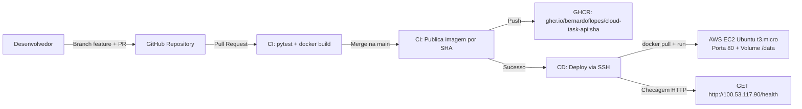
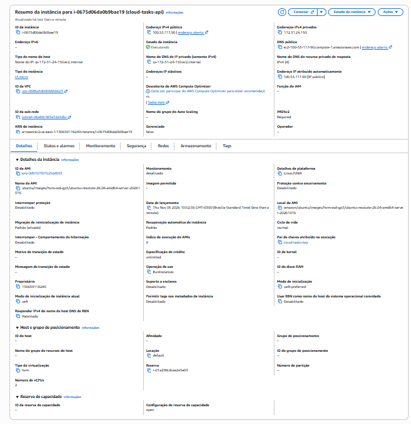
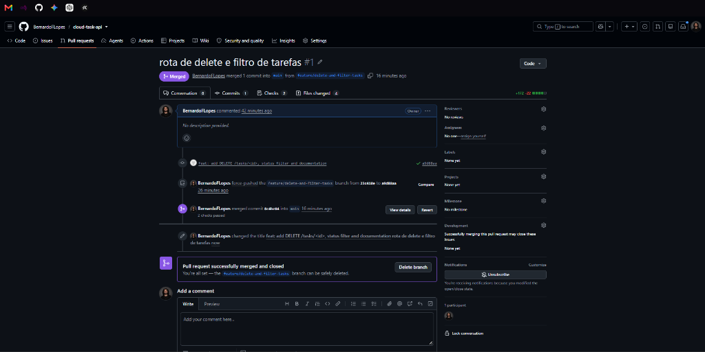
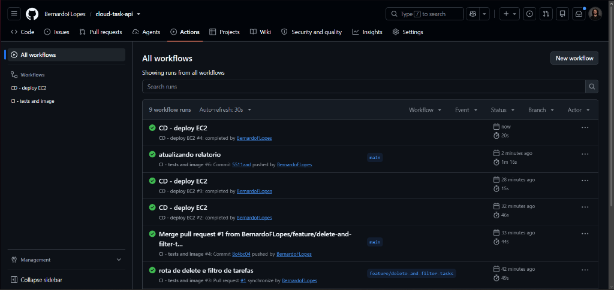
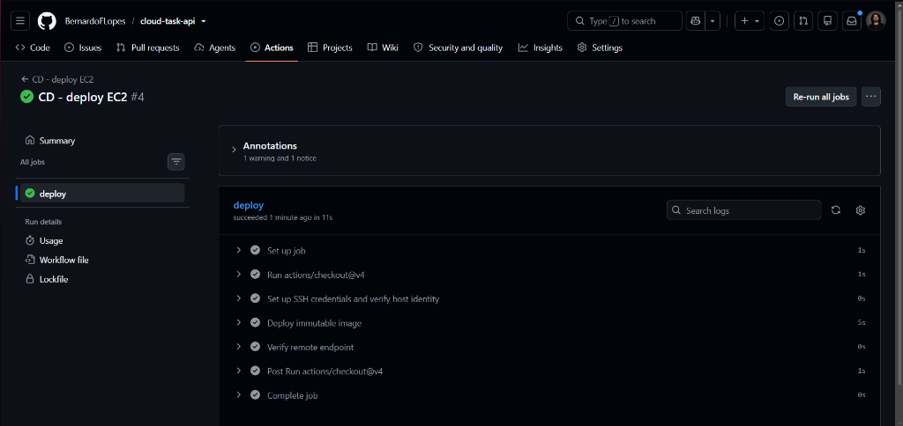
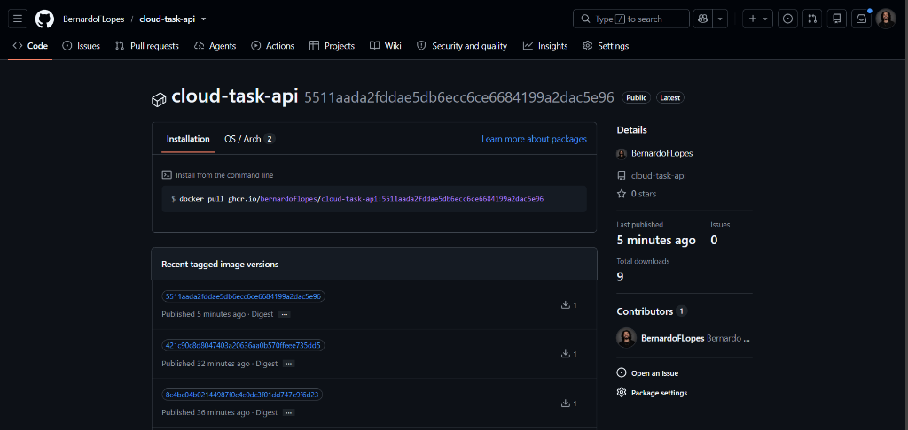
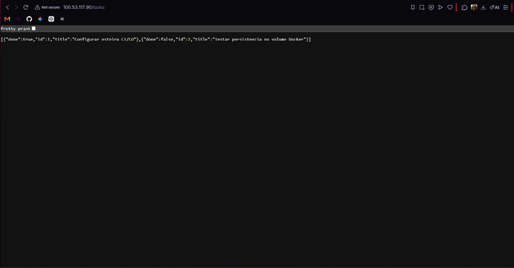
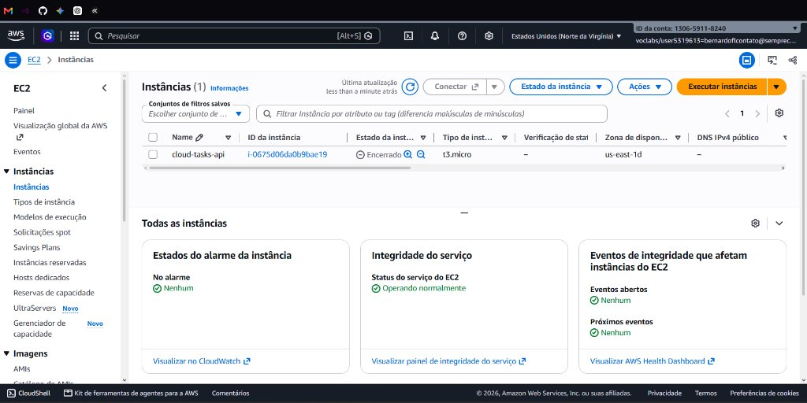

# Relatório do Trabalho Final — Computação em Nuvem

**Aluno:** Bernardo Ferreira Lopes (RA: 22309764)  
**Repositório:** https://github.com/BernardoFLopes/cloud-task-api  
**Pull Request (#1):** https://github.com/BernardoFLopes/cloud-task-api/pull/1  
**CI Run (GitHub Actions):** https://github.com/BernardoFLopes/cloud-task-api/actions/runs/42041807789  
**CD Run (Deploy EC2):** https://github.com/BernardoFLopes/cloud-task-api/actions/runs/42041930606  
**IP / URL da Aplicação:** `http://100.53.117.90/health` e `http://100.53.117.90/tasks`

---

## 1. Integrantes e Contribuições
- **Bernardo Ferreira Lopes (RA: 22309764)**: Responsável por todo o desenvolvimento (trabalho individual), incluindo a implementação do endpoint `DELETE /tasks/<id>`, o filtro de tarefas por status (`GET /tasks?done=`), os testes automatizados com `pytest`, a configuração da instância AWS EC2 e a validação da esteira CI/CD no GitHub Actions.

---

## 2. Diagrama do Fluxo e Arquitetura

---

## 3. Infraestrutura AWS EC2 e Portas

- **Instância:** `i-0675d06da0b9bae19` (`cloud-tasks-api`), tipo `t3.micro` (Free Tier), região `us-east-1`.
- **Sistema Operacional:** Ubuntu Server LTS (64 bits x86) com Docker instalado via `scripts/setup-ec2-ubuntu.sh`.
- **Endereço Público:** `100.53.117.90` (`ec2-100-53-117-90.compute-1.amazonaws.com`).
- **Security Group (Portas liberadas):**
  - **Porta 80 (HTTP / TCP):** Aberta para testes externos da API e verificação automática do endpoint `/health`.
  - **Porta 22 (SSH / TCP):** Utilizada para administração e execução remota do script `scripts/deploy.sh` pelo GitHub Actions.
- **Secrets e Variáveis no GitHub:** Foram configurados `EC2_HOST`, `EC2_SSH_KEY`, `EC2_KNOWN_HOSTS` e a variável `EC2_USER=ubuntu`.

---

## 4. Evolução Funcional e Testes

Foram adicionadas duas funcionalidades em `app/main.py` e novos testes em `tests/test_api.py` (totalizando 8 testes passando no `pytest`):
1. **`DELETE /tasks/<id>`:** Remove uma tarefa pelo ID no SQLite, retornando `204 No Content` quando removida ou `404 Not Found` caso não exista (testado por `test_delete_task_success` e `test_delete_task_not_found`).
2. **Filtro `GET /tasks?done=true|false`:** Filtra tarefas concluídas ou pendentes via query string (testado por `test_filter_tasks_by_done`).

---

## 5. Evidências da Esteira CI/CD e Persistência

### 5.1. Pull Request e Revisão
As alterações foram desenvolvidas na branch `feature/delete-and-filter-tasks` e integradas na `main` após aprovação da CI no Pull Request #1:

### 5.2. Execução do CI e CD no GitHub Actions
Após o merge na `main`, a CI publicou a imagem com a tag do SHA do commit e disparou automaticamente o workflow `CD - deploy EC2`:

Detalhe das etapas do deploy via SSH e verificação do `/health` na EC2:

### 5.3. Imagem Publicada no GHCR (Versionada por SHA)
Pacote público gerado automaticamente no GitHub Container Registry:

### 5.4. Persistência de Dados no Contêiner
O script de deploy monta o volume Docker `-v cloud-tasks-data:/data` (`DB_PATH=/data/tasks.db`). Para comprovar a persistência, foram criadas duas tarefas na API, o contêiner foi reiniciado/recriado em novo deploy e os dados permaneceram intactos no banco SQLite:

---

## 6. Dificuldades Encontradas e Custos/Encerramento
- **Dificuldades:** Foi necessário ajustar a visibilidade do pacote no GHCR para *Public* (permitindo `docker pull` na EC2 sem credenciais salvas) e configurar a chave `known_hosts` da instância nos Secrets do repositório para o SSH funcionar sem erro de verificação de host.
- **Custos e Encerramento:** Utilizou-se apenas uma instância `t3.micro` na conta AWS Academy/Free Tier. Após os testes e coleta das evidências para entrega, a instância EC2 (`i-0675d06da0b9bae19`) e seu volume EBS foram devidamente encerrados (*Encerrado / Terminated*) pelo console da AWS para evitar qualquer cobrança:

